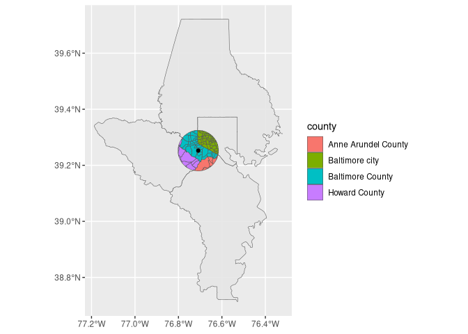
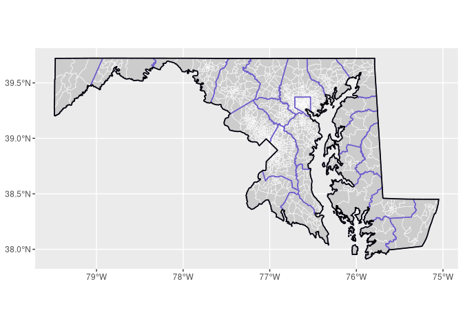
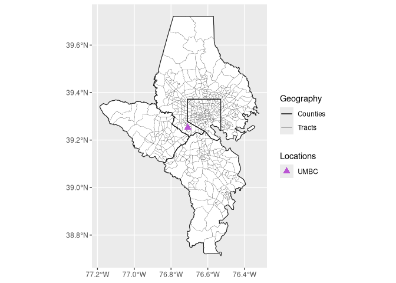

# Spatial data basics


## Spatial operations

``` r
library(ggplot2)
```

Now that you’re set up for working with spatial data in R, we’ll
practice a few common tasks that, all combined, will get you a nice map.

First, search for an address within Maryland where you want to focus
your map (don’t use anything personal, our lab repos are public!) on
OpenStreetMap’s behind-the-scenes [search
engine](https://nominatim.openstreetmap.org/ui/search.html). Find the
result you want and click “details.” In the table on the next page
you’ll see coordinates for this result; use those to create an `sf`
point object. Its CRS code is 4269.

``` r
# enter the coords inside c() as numbers in the order longitude, latitude
center_coords <- sf::st_point(x = c(-76.4001838,39.315527))
center_web_merc <- sf::st_sfc(center_coords,crs = 4269)
```

Now use `sf::st_transform()` to transform that to a CRS that uses feet
and is focused on Maryland (2248). Verify that it has units “ftUS”:

``` r
center_proj <- sf::st_transform(center_web_merc,2248)
center_proj
```

    Geometry set for 1 feature 
    Geometry type: POINT
    Dimension:     XY
    Bounding box:  xmin: 1482041 ymin: 601062.4 xmax: 1482041 ymax: 601062.4
    Projected CRS: NAD83 / Maryland (ftUS)

    POINT (1482041 601062.4)

Create a buffer of 5 miles around that center point (1 mile = 5280 feet)
(feel free to change the radius if you want):

``` r
center_buff <- sf::st_buffer(center_proj, dist = 5 * 5280)
center_buff
```

    Geometry set for 1 feature 
    Geometry type: POLYGON
    Dimension:     XY
    Bounding box:  xmin: 1455641 ymin: 574662.4 xmax: 1508441 ymax: 627462.4
    Projected CRS: NAD83 / Maryland (ftUS)

    POLYGON ((1508441 601062.4, 1508405 599680.7, 1...

``` r
# very boring plot
ggplot(center_buff) +
  geom_sf()
```


Use `tigris::tracts` to get tracts for all of Maryland
(`justviz::tracts_sf` is a subset, so get a fresh copy). Set the
argument `cb = TRUE` to get simplified boundaries that are better for
mapping, and `progress_bar = FALSE` so your markdown doesn’t get flooded
with lines. Then use the tracts and `dplyr`’s `group_by` and `summarise`
to merge tracts together to form counties.

``` r
tracts_sf <- tigris::tracts(state = "MD", cb = TRUE,progress_bar=FALSE) |>
  dplyr::select(geoid = GEOID, county = NAMELSADCO)
```

    Retrieving data for the year 2025

``` r
counties_sf <- tracts_sf |>
    dplyr::group_by(county) |>
    dplyr::summarise()
  # group by counties & summarise
ggplot(counties_sf) +
  geom_sf()
```


Get the intersection of the buffer and the tract shapes. To do this,
they’ll need to have the same CRS. To find an `sf` object’s CRS, call
`sf::st_crs` on it. If the CRSes are not the same, you’ll have to
reproject one to match the other. Put the tracts on the left side of
your `sf::st_intersection` call so you can retain other info like FIPS
codes.

``` r
sf::st_crs(tracts_sf)
```

    Coordinate Reference System:
      User input: NAD83 
      wkt:
    GEOGCRS["NAD83",
        DATUM["North American Datum 1983",
            ELLIPSOID["GRS 1980",6378137,298.257222101,
                LENGTHUNIT["metre",1]]],
        PRIMEM["Greenwich",0,
            ANGLEUNIT["degree",0.0174532925199433]],
        CS[ellipsoidal,2],
            AXIS["latitude",north,
                ORDER[1],
                ANGLEUNIT["degree",0.0174532925199433]],
            AXIS["longitude",east,
                ORDER[2],
                ANGLEUNIT["degree",0.0174532925199433]],
        ID["EPSG",4269]]

``` r
sf::st_crs(center_buff)
```

    Coordinate Reference System:
      User input: EPSG:2248 
      wkt:
    PROJCRS["NAD83 / Maryland (ftUS)",
        BASEGEOGCRS["NAD83",
            DATUM["North American Datum 1983",
                ELLIPSOID["GRS 1980",6378137,298.257222101,
                    LENGTHUNIT["metre",1]]],
            PRIMEM["Greenwich",0,
                ANGLEUNIT["degree",0.0174532925199433]],
            ID["EPSG",4269]],
        CONVERSION["SPCS83 Maryland zone (US survey foot)",
            METHOD["Lambert Conic Conformal (2SP)",
                ID["EPSG",9802]],
            PARAMETER["Latitude of false origin",37.6666666666667,
                ANGLEUNIT["degree",0.0174532925199433],
                ID["EPSG",8821]],
            PARAMETER["Longitude of false origin",-77,
                ANGLEUNIT["degree",0.0174532925199433],
                ID["EPSG",8822]],
            PARAMETER["Latitude of 1st standard parallel",39.45,
                ANGLEUNIT["degree",0.0174532925199433],
                ID["EPSG",8823]],
            PARAMETER["Latitude of 2nd standard parallel",38.3,
                ANGLEUNIT["degree",0.0174532925199433],
                ID["EPSG",8824]],
            PARAMETER["Easting at false origin",1312333.333,
                LENGTHUNIT["US survey foot",0.304800609601219],
                ID["EPSG",8826]],
            PARAMETER["Northing at false origin",0,
                LENGTHUNIT["US survey foot",0.304800609601219],
                ID["EPSG",8827]]],
        CS[Cartesian,2],
            AXIS["easting (X)",east,
                ORDER[1],
                LENGTHUNIT["US survey foot",0.304800609601219]],
            AXIS["northing (Y)",north,
                ORDER[2],
                LENGTHUNIT["US survey foot",0.304800609601219]],
        USAGE[
            SCOPE["Engineering survey, topographic mapping."],
            AREA["United States (USA) - Maryland - counties of Allegany; Anne Arundel; Baltimore; Calvert; Caroline; Carroll; Cecil; Charles; Dorchester; Frederick; Garrett; Harford; Howard; Kent; Montgomery; Prince Georges; Queen Annes; Somerset; St Marys; Talbot; Washington; Wicomico; Worcester."],
            BBOX[37.97,-79.49,39.73,-74.97]],
        ID["EPSG",2248]]

``` r
tracts_sf_proj <- sf::st_transform(tracts_sf,2248)

#buff_reproj <- sf::st_transform(center_buff)
tracts_in_buffer <- sf::st_intersection(tracts_sf_proj, center_buff)
```

    Warning: attribute variables are assumed to be spatially constant throughout
    all geometries

``` r
tracts_in_buffer
```

    Simple feature collection with 32 features and 2 fields
    Geometry type: GEOMETRY
    Dimension:     XY
    Bounding box:  xmin: 1455641 ymin: 575052.8 xmax: 1504330 ymax: 627462.4
    Projected CRS: NAD83 / Maryland (ftUS)
    First 10 features:
              geoid           county                       geometry
    53  24005450800 Baltimore County POLYGON ((1468214 603925.3,...
    149 24005411307 Baltimore County POLYGON ((1466631 622447.1,...
    154 24005450501 Baltimore County POLYGON ((1463588 599860.9,...
    195 24005450400 Baltimore County POLYGON ((1459617 597789.4,...
    255 24005450300 Baltimore County POLYGON ((1460668 601029.5,...
    291 24005450200 Baltimore County POLYGON ((1457423 599294.1,...
    338 24005451500 Baltimore County POLYGON ((1470121 605465.2,...
    358 24005450100 Baltimore County POLYGON ((1457153 607045.8,...
    459 24005452300 Baltimore County POLYGON ((1456861 595962.9,...
    480 24005451401 Baltimore County POLYGON ((1468080 613104.9,...

``` r
ggplot(tracts_in_buffer) +
  geom_sf()
```


Here’s a confusing step: you already found the *intersection* of the
buffer and another polygon, which creates a new shape. Now you’re going
to find *which shapes intersect*; this doesn’t change the shape, just
returns true/false values. This is a predicate function. If you just
call the predicate function itself, you’ll get a matrix showing whether
each shape on the left (24 counties) intersects at all with the shape on
the right (1 buffer polygon).

``` r
counties_sf_proj <- sf::st_transform(counties_sf,2248)

sf::st_intersects(counties_sf_proj, center_buff)
```

    Sparse geometry binary predicate list of length 24, where the predicate
    was `intersects'
    first 10 elements:
     1: (empty)
     2: (empty)
     3: 1
     4: (empty)
     5: (empty)
     6: (empty)
     7: (empty)
     8: (empty)
     9: (empty)
     10: (empty)

There are a few ways to do this, but we’ll make a sparse matrix of which
counties intersect with the buffer, then keep the counties that have
values in the matrix. The function `lengths` gives the length of each
element in a vector; in this case, that will give us how many times
shapes from one object intersect shapes from the other object, and we
can filter for anywhere that has 1 or more intersections.

``` r
counties_mask <- sf::st_intersects(counties_sf_proj,center_buff)
counties_mask
```

    Sparse geometry binary predicate list of length 24, where the predicate
    was `intersects'
    first 10 elements:
     1: (empty)
     2: (empty)
     3: 1
     4: (empty)
     5: (empty)
     6: (empty)
     7: (empty)
     8: (empty)
     9: (empty)
     10: (empty)

``` r
lengths(counties_mask)
```

     [1] 0 0 1 0 0 0 0 0 0 0 0 0 0 0 0 0 0 0 0 0 0 0 0 0

``` r
nearby_counties <- counties_sf_proj |> dplyr::filter(lengths(counties_mask) > 0)
```

That should give you a subset of counties—in my case, I have 4.

Finally put it all together. Call `ggplot` as usual, but leave it empty
since you’ll have multiple datasets for the different layers. Then add
`geom_sf` calls for `nearby_counties`, `tracts_in_buffer`, and
`center_web_merc`, adjusting whatever you want including any `aes` calls
inside your layers. Give each `geom_sf` call a data frame with
`data = __`.

My ugly example looks like this:



``` r
ggplot()+
  geom_sf(data =nearby_counties,fill="lightyellow")+
  geom_sf(data =tracts_in_buffer,fill="lightblue")+
  geom_sf(data =center_web_merc,fill="black")+
  theme_minimal()
```


## Layers

We use `geom_sf` a little differently from other geoms, where it’s
common to add up multiple layers with different data frames. Normally
we’d have a data frame in our original `ggplot` call, and its scales and
any aesthetics assigned in that initial call trickle down to the geoms
that follow unless we reassign them (or cancel them out with
`inherit.aes = FALSE`). But because we’ll have different data frames for
each layer, it can be better to leave the `ggplot` call empty and give
each `geom_sf` its own `data` argument.

In the same way that you created `counties_sf` by summarizing tract
geometries by county, create a shape `state_sf` where you summarize all
the tracts into one geometry for the state. You now have 3 geographic
levels (tracts, counties, and state) that can nest within each other
using 3 different layers. Stack the layers and set any aesthetics you
want (linewidth and color are both good) to get a map of Maryland that
shows all 3 layers distinct from one another, i.e. it’s clear which
boundaries are for counties and which are for tracts. Hard-code the
aesthetics in each geom instead of using `aes`.

A hint: `alpha = 0` will get you a geom with borders but no visible
fill, as will `fill = NA` or `fill = "transparent"`.

My example is here. It’s chaotic to highlight the different settings you
can use; make yours look better.



``` r
#get state layer
tracts_sf2 <- tigris::tracts(state = "MD", cb = TRUE,progress_bar=FALSE) |>
  dplyr::select(geoid = GEOID, county = NAMELSADCO,state=STATEFP)
```

    Retrieving data for the year 2025

``` r
states_sf <- tracts_sf2 |>
    dplyr::group_by(state) |>
    dplyr::summarise()
  
states_sf_proj <- sf::st_transform(states_sf,2248)

ggplot(states_sf_proj) +
  geom_sf()
```


``` r
#map
ggplot()+
  geom_sf(data =states_sf_proj,fill=NA,linewidth=1,colour="black")+
  geom_sf(data =counties_sf_proj,aes(fill=county,alpha=0.3))+
  geom_sf(data =tracts_sf_proj,fill=NA)+
  theme_minimal()+
  theme(legend.position = "none")
```


## Legend hacking

Legends in ggplot are normally tough, and with `sf` data they’re even
worse. Normally a geom can take a true/false/NA value for `show.legend`
to determine whether there will be a corresponding legend entry. With
`geom_sf`, this argument can take values for the type of shape to show
as well. This gives us more options and more headaches.

Normally we’d want tidy data with a variable to map onto our aesthetics
(e.g. some group that we assign to color), but since we often have
different spatial data in different data frames, we’ll use separate
`geom_sf` calls and hard-code fake aesthetics to get a legend. For
example, instead of `aes(linewidth = level)` like we would do with a
line chart, `aes(linewidth = "Counties")` will force a legend that shows
a line or polygon key for counties.

There are a lot of different options for changing your legend keys,
including:

- setting a legend type, e.g. `show.legend = "line"` inside `geom_sf`
- turning on & off multiple legend types,
  e.g. `show.legend = c(shape = TRUE, color = FALSE)` inside `geom_sf`
- overriding parts of the legend with a list of options,
  e.g. `guide = guide_legend(override.aes = list(linewidth = 0))` inside
  a scale call
- changing the key type with a `key_glyph` argument inside a geom
  (unfortunately not as well documented as other arguments)

To combine multiple legends into one (e.g. color and linewidth), give
their aesthetics the same name in a call to `labs`.

My example here took 3 calls to `geom_sf`; 3 manual scales, one of which
needed an `override.aes` inside its guide; and a `labs` call to merge
legends.



``` r
nearby_tracts <- tracts_sf |>
  dplyr::filter(county %in% nearby_counties$county)

ggplot()+
  geom_sf(data =nearby_counties,aes(color="Counties"),fill="lightyellow")+
  geom_sf(data =tracts_in_buffer, aes(color="Tracts"),fill=NA,linewidth=1)+
  geom_sf(data =center_web_merc, aes(color="Center"))+
  theme_minimal()+
  scale_color_manual(values=c("Counties"="black","Tracts"="lightgrey", "Center"="hotpink"))+
  labs(color="Legend")
```


## Joins

### Spatial & nonspatial

To practice joining a spatial data frame and a nonspatial one, you’ll
join `justviz::vacants_by_tract` with your `tracts_sf` in a few ways.
The first of these is a count of vacant building notices per tract
within Baltimore city.

First, do an inner join (`dplyr::inner_join`). You want to end up with
an `sf` data frame with one row per city tract, with only the tracts
that have vacancies and are included in the vacancy data. Remember my
warning about which data frame type needs to be on the left—in order to
use `geom_sf` easily, you need an `sf` data frame.

You should have an `sf` data frame with 182 rows. Once you have that,
make a map of it, just showing the tracts included.

``` r
vac<-justviz::vacants_by_tract

tracts_with_vacants <- tracts_sf |>
  dplyr::inner_join(vac, by = "geoid")

  class(tracts_with_vacants)
```

    [1] "sf"         "data.frame"

``` r
ggplot()+
  geom_sf(data =tracts_with_vacants)
```


With that map, you only draw tracts that are included in both data
frames, i.e. tracts in Baltimore city that have at least one vacant
notice. Now use a left join so you can keep all tract geometries in the
city, but attach the data about vacancies to it. Filter the tracts data
frame for just Baltimore city, then do your join.

There are 199 tracts in the city, so your result should be an `sf` data
frame with 199 rows. Make a map of this, with tracts filled based on
whether there are any vacancies. Without changing the data, this will be
denoted with the fact that `n_vacants` will be NA for rows not in
`vacants_by_tract`. Replace NAs with 0 using
`tidyr::replace_na(n_vacants, replace = 0)`. Then use `ifelse` to create
a variable `has_vacants` with one value for tracts with n_vacants \> 0
and another value for other tracts (e.g. “Has vacants” / “No vacants”).
Map `has_vacants` to fill, and set a scale that highlights tracts with
vacants.

``` r
balt_sf <- tracts_sf |>
  dplyr::filter(county == "Baltimore city")

balt_tract_vacants_sf <- balt_sf |>
  dplyr::left_join(vac,by="geoid")|>
  tidyr::replace_na(list(n_vacants = 0))|>
  dplyr::mutate(has_vacants = ifelse(n_vacants>0,"Has vacants","No vacants"))
  # join, replace_na, ifelse

ggplot()+
  geom_sf(data =balt_tract_vacants_sf,aes(fill=has_vacants))+
  scale_fill_manual(
    values = c("Has vacants" = "pink","No vacants" = "grey"))
```


``` r
#had to modify replace_na syntax here, it was not running, so debugged with chatgpt, not sure if this is the right way to go about using replace_na
```

Repeat that, but this time highlight tracts with more than some certain
number of vacants instead of 0. Change the categories you use for
`has_vacants` accordingly (e.g. “50+ vacants” / “\<50 vacants”).

``` r
balt_sf <- tracts_sf |>
  dplyr::filter(county == "Baltimore city")

balt_tract_vacants_sf <- balt_sf |>
  dplyr::left_join(vac,by="geoid")|>
  tidyr::replace_na(list(n_vacants = 0))|>
  dplyr::mutate(has_vacants = ifelse(n_vacants>50,"50+ vacants","<50 vacants"))
  # join, replace_na, ifelse

ggplot()+
  geom_sf(data =balt_tract_vacants_sf,aes(fill=has_vacants))+
  scale_fill_manual(
    values = c("50+ vacants" = "pink","<50 vacants" = "grey"))
```


### Spatial & spatial

Last, you’ll do a spatial join, where you join one spatial data frame to
another based on some predicate function. You’re actually doing what I
did to create `justviz::vacants_by_tract`.

Take your Baltimore city tracts, and do a spatial join with
`justviz::vacants_sf` using `sf::st_join`. Make sure to set
`left = FALSE` to do an inner join, so you’re only left with tracts that
contain at least 1 vacant. After the join, you should have an `sf` data
frame with more than 11,000 rows, one per vacant building. Each vacant
will now have a tract associated with it. At this point, you don’t need
the geometries, so drop them with `sf::st_drop_geometry`. Then call
`dplyr::count` grouping by GEOID to get a count of vacant buildings in
each tract. This should have the same number of rows as
`justviz::vacants_by_tract`.

``` r
balt_sf |>
  dplyr::filter(county == "Baltimore city")|>
  sf::st_join(justviz::vacants_sf,left=FALSE)|>
  sf::st_drop_geometry()|>
  dplyr::count(geoid,name = "n_vacants")
```

              geoid n_vacants
    1   24510010100         5
    2   24510010200         5
    3   24510010300         2
    4   24510010400         3
    5   24510010500         2
    6   24510020100         2
    7   24510020200         7
    8   24510020300        14
    9   24510030100        19
    10  24510030200        11
    11  24510040100        50
    12  24510040200         3
    13  24510060100        30
    14  24510060200        36
    15  24510060300        17
    16  24510060400         7
    17  24510070100        83
    18  24510070200       161
    19  24510070300        34
    20  24510070400         7
    21  24510080101        16
    22  24510080102        43
    23  24510080200       239
    24  24510080301       214
    25  24510080302        35
    26  24510080400       151
    27  24510080500       148
    28  24510080600       358
    29  24510080700       102
    30  24510080800        18
    31  24510090100        20
    32  24510090200         7
    33  24510090300        16
    34  24510090400        21
    35  24510090500        16
    36  24510090600        74
    37  24510090700       155
    38  24510090800       318
    39  24510090900       183
    40  24510100100        95
    41  24510100200         7
    42  24510110100         3
    43  24510110200         9
    44  24510120100         1
    45  24510120201        23
    46  24510120202         1
    47  24510120300        36
    48  24510120400        28
    49  24510120500        16
    50  24510120600        10
    51  24510120700         8
    52  24510130100        17
    53  24510130200        15
    54  24510130300       196
    55  24510130400       112
    56  24510130600         6
    57  24510130700        12
    58  24510130804         6
    59  24510130806         3
    60  24510140100         1
    61  24510140200       111
    62  24510140300       169
    63  24510150100       126
    64  24510150200       350
    65  24510150300       121
    66  24510150400       318
    67  24510150500        19
    68  24510150600       267
    69  24510150701        18
    70  24510150702        36
    71  24510150800        58
    72  24510150900        61
    73  24510151000        59
    74  24510151100        22
    75  24510151200       196
    76  24510151300       233
    77  24510160100       235
    78  24510160200       165
    79  24510160300       130
    80  24510160400       497
    81  24510160500       108
    82  24510160600       314
    83  24510160700       274
    84  24510160801        13
    85  24510160802        44
    86  24510170100         5
    87  24510170200        38
    88  24510170300        80
    89  24510180300        49
    90  24510190100       120
    91  24510190200       216
    92  24510190300       315
    93  24510200100       185
    94  24510200200       301
    95  24510200300       350
    96  24510200400       255
    97  24510200500       410
    98  24510200600        98
    99  24510200701        82
    100 24510200702        49
    101 24510200800        38
    102 24510210100        19
    103 24510210200        72
    104 24510220100         4
    105 24510230100         3
    106 24510230200         2
    107 24510240100         2
    108 24510240200         1
    109 24510250101         4
    110 24510250102         6
    111 24510250103         3
    112 24510250203        22
    113 24510250204        18
    114 24510250205        16
    115 24510250206        16
    116 24510250207         9
    117 24510250301       141
    118 24510250303        35
    119 24510250401        60
    120 24510250402        70
    121 24510250500       136
    122 24510260101         6
    123 24510260102        11
    124 24510260201         5
    125 24510260202        14
    126 24510260203         2
    127 24510260301        26
    128 24510260302         8
    129 24510260403         1
    130 24510260404        40
    131 24510260501        15
    132 24510260604         3
    133 24510260605        11
    134 24510260700         7
    135 24510260800        20
    136 24510260900         4
    137 24510261000        47
    138 24510261100        11
    139 24510270101        10
    140 24510270102         7
    141 24510270200         4
    142 24510270301         4
    143 24510270302         8
    144 24510270401        10
    145 24510270402         6
    146 24510270501         4
    147 24510270502         6
    148 24510270600         6
    149 24510270702         2
    150 24510270703         7
    151 24510270801         6
    152 24510270802         3
    153 24510270803         7
    154 24510270804         1
    155 24510270805        15
    156 24510270901         3
    157 24510270902         1
    158 24510270903         2
    159 24510271001        27
    160 24510271002        39
    161 24510271101         5
    162 24510271102         6
    163 24510271200         4
    164 24510271400         3
    165 24510271501         5
    166 24510271600        72
    167 24510271700        96
    168 24510271801       102
    169 24510271802       181
    170 24510271900         8
    171 24510272003         2
    172 24510272007         3
    173 24510280101        12
    174 24510280102        26
    175 24510280200        17
    176 24510280301         3
    177 24510280302         9
    178 24510280401         4
    179 24510280402         7
    180 24510280403         8
    181 24510280500        46
    182 24510280600        42

``` r
  # join, drop, count

justviz::vacants_by_tract
```

    # A tibble: 182 × 2
       geoid       n_vacants
       <chr>           <int>
     1 24510010100         5
     2 24510010200         5
     3 24510010300         2
     4 24510010400         3
     5 24510010500         2
     6 24510020100         2
     7 24510020200         7
     8 24510020300        14
     9 24510030100        19
    10 24510030200        11
    # ℹ 172 more rows
